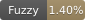
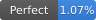
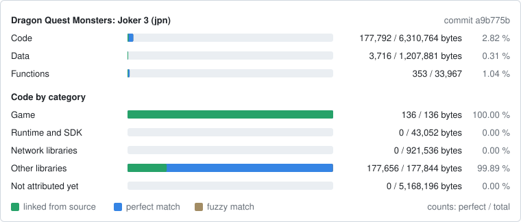

Dragon Quest Monsters: Joker 3 (Nintendo 3DS)
=============================================

> [!IMPORTANT]
> AI Disclosure:
> AI was used for the following tasks:
> - Writing commentary (primarily translating into English and formatting).
> - Documenting and citing the various sources used in the project (see PROVENANCE.md, REFERENCES.md, and more generally the files contained within the "notes" directory).
> - Writing code (C, C++, Python, etc.—I used it as a tool) and reviewing my own work (yes, some code was written by AI, but it was verified by a human; I didn't simply type "Claude, decompile this for me").

A work-in-progress matching decompilation of Dragon Quest Monsters: Joker 3 for the
Nintendo 3DS. The build system comes from [BigRed](https://github.com/T3CHNOLOG1C/BigRed)
(New Super Mario Bros. 2), see `notes/BUILD_SYSTEM.md`.

> [!NOTE]
> No port to PC or other platforms is planned for the time being, but should that change, the link will appear here

This repository does **not** contain any game assets or assembly whatsoever. An existing
copy of the game is required.

It builds the following version:

Name | Description | SHA-1 of the decompressed `code.bin`
---- | ----------- | ------------------------------------
jpn  | Japan, `CTR-P-BJ3J`, remaster version 0 | `0d9795cacac26c967390f02355dc409132227553`

Progress
========

| Release | Game code | Progress |
|---|---|---|
| Dragon Quest Monsters: Joker 3 (Japan) | `CTR-P-BJ3J` | [](notes/PROGRESS.md) [](notes/PROGRESS.md) [](notes/PROGRESS.md) |

[](notes/PROGRESS.md)

- **Fuzzy**: objdiff fuzzy match score over all code.
- **Perfect**: code that matches byte for byte.
- **Linked**: code built from source (`Matching` units of `configure.py`).

The badges and the card are drawn from the objdiff report by
`tools/progress_badges.py`. After a build, `python tools/progress_badges.py --record`
redraws `progress/jpn/` and adds the current commit to `progress/jpn/history.csv`.

Dependencies
============

- [Python](https://www.python.org/downloads/) 3.11 or newer in `%PATH%`. No additional
  packages are needed.
- [ninja](https://github.com/ninja-build/ninja/releases) in `%PATH%`
  (`pip install ninja` works too).
- [ctrtool](https://github.com/3DSGuy/Project_CTR) to extract the code from your dump.
- On Windows use native tooling; WSL or msys2 are not required. On Linux and macOS,
  [wibo](https://github.com/decompals/wibo) is downloaded to run the compiler.

The compiler (RVCT `armcc`) and objdiff-cli are downloaded by the first build.

Building
========

1. Extract the decompressed code from a decrypted dump:

   ```
   ctrtool -n 0 --exefsdir=extract/jpn/exefs --decompresscode <dump>.3ds
   ```

   and copy `extract/jpn/exefs/code.bin` to `orig/jpn/code.bin` (7,487,488 bytes,
   SHA-1 above).
2. Run:

   ```
   python configure.py
   ninja
   ```

   A build ends by checking that the rebuilt `build/jpn/code.bin` is identical to the
   original (`build\jpn\code.bin: OK`) and printing the progress.

Diffing
=======

`python configure.py` writes `objdiff.json`; open the repository folder in
[objdiff](https://github.com/encounter/objdiff). `ninja report` writes
`build/jpn/report.json`.

Documentation
=============

- `SPEC.md`: target image, toolchain, acceptance criteria, naming.
- `notes/BUILD_SYSTEM.md`: how the image is split, compiled, linked and checked.
- `notes/`: compiler evidence, region map, matching techniques, references and
  provenance of reused code, progress log.
